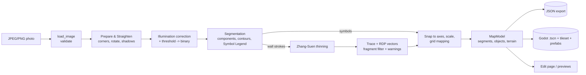

# Architecture

| SRS feature | Modules |
|---|---|
| 1 Preprocessing + segmentation | `preprocess.py`, `segmentation.py`, `elements.py` (Symbol Legend) |
| 2 Thinning + vectors | `thinning.py`, `vectorize.py`, `rdp.py` |
| 3 Grid + export | `pipeline.build_model`, `gridmap.py`, `exporters.py`, `godot_export.py`, `schema.py` |
| 4 GUI | `ui/main_window.py`, `ui/pages/*`, `ui/adjust_dialog.py`, `ui/stats_panel.py` |

`pipeline.run_pipeline` is the single entry point used by the GUI worker thread, the CLI, the tests and the benchmark.
Stage A (image -> vectors) is independent of the scale; stage B (`build_model`) is cheap and re-runs when the scale changes.
The GUI runs the pipeline in a `QThread` (`Worker`) so the window stays responsive (SRS 5.1.2).
