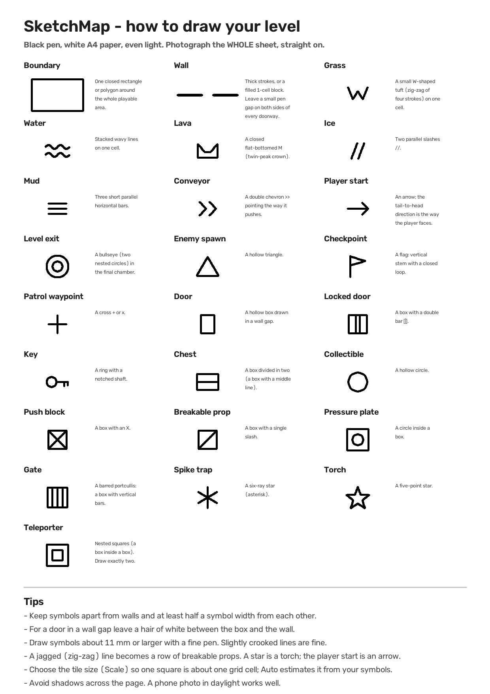

# SketchMap 0.2.0 - User Manual

SketchMap turns a photo or scan of a hand-drawn level into an editable 2D grid map, and exports it as a **JSON** file (any engine)
or a **Godot scene (.tscn)** with a tile map and physics colliders. It runs completely **offline**: there are no accounts, no logins
and nothing is ever sent over a network.

## 1. What you need

- A Windows, macOS or Linux computer (x86/x64; 2 GHz dual-core, 4 GB RAM and 500 MB free disk is enough).
- A photo or scan of your sketch as **JPEG or PNG**.
- To use the result: Godot 4 (for `.tscn`) or any program that can read JSON.

## 2. Drawing your sketch

- Use a **black pen on white A4 paper**, in even light, and capture the **whole sheet**.
- Draw walls along the paper edges (horizontal / vertical). Slightly crooked lines are straightened automatically; diagonal lines are forced to the nearest axis.
- Leave a gap in a wall for a doorway.
- Keep symbols **apart from walls** (a symbol that touches a wall is read as part of the wall; for a door in a wall gap leave a hair of white), and leave at least half a symbol's width between neighbours.
- Draw each symbol about 11 mm or larger with a fine pen. Multi-stroke symbols (ice, mud, water, conveyor) only need their strokes drawn close together.
- Draw one closed rectangle around the whole map: that is the **boundary**.

## 3. Step by step

1. **Import.** Press **Import File** (Ctrl+O) or drag a picture onto the window. Only JPEG and PNG pictures are accepted. A broken, empty, blank or very low-contrast picture shows a clear message instead of a result.
2. **Prepare & Straighten.** A window shows your photo. Drag the four paper corners if the page is not flat, rotate to level the walls (**Auto**), and tune lighting and the threshold until the walls look solid black on white. Press **OK**.
3. **Wait a moment.** SketchMap removes shadows, finds walls and symbols, thins strokes to one pixel (Zhang-Suen), simplifies them (Ramer-Douglas-Peucker), snaps them to a grid and builds the map. A normal sketch takes well under a second.
4. **Check.** The Home page shows the result and the file name is shown in the window title. Open **Edit** to see the grid-mapped map and compare it with your drawing (switch **Sketch overlay** on). Press **Ctrl+I** (Stats for nerds) and choose **Pipeline stages** to see the *Original*, *Preprocessed*, *Segmented* and *Thinned* previews one below the other.
5. **Fix.** In Edit mode, draw or erase walls and place any element from the palette. **Ctrl+Z / Ctrl+Y** undo and redo. Stray strokes that were too fragmented to use are marked with an orange **!** on the segmented and thinned previews, and listed under *Warnings* in Stats for nerds.
6. **Scale.** *Scale* is the real size of one grid cell on the paper (mm). Bigger means a coarser grid. **Auto** estimates it from your symbols.
7. **Export.** Choose **JSON** or **Godot (.tscn)** and a folder. If a file with that name already exists, SketchMap asks before replacing it.

## 4. Pages

- **Home** - your current map and the Import / Open buttons. Drag and drop works anywhere in the window.
- **Library** - every element, how to draw it, and what it becomes in Godot.
- **Files** - recently opened sketches and levels (favourites, search).
- **Templates** - two sample sketches to try the program.
- **Menu (the three-line button, bottom left)** - this manual (F1), the symbol legend, keyboard shortcuts, settings and *About*.
- **Themes** - *Menu → Theme* switches the look instantly: *Match system* (follows your OS light/dark setting), *Dark*, *Light*, *Midnight* or *High contrast*. Your choice is remembered (also under *Settings → Appearance*).

## 5. Elements

**Structure**

| Element | How to draw it | In Godot | Detected |
|---|---|---|---|
| Boundary | One closed rectangle or polygon around the whole playable area. | Walls_Boundary layer: solid collider on Physics Layer 0 so nothing can leave the level. | auto |
| Wall | Thick strokes, or a filled 1-cell block. Leave a small pen gap on both sides of every doorway. | Walls_Boundary layer: solid collider on Physics Layer 0, blocks light (occluder). | auto |

**Terrain**

| Element | How to draw it | In Godot | Detected |
|---|---|---|---|
| Grass | A small W-shaped tuft (zig-zag of four strokes) on one cell. | Ground_Terrain: walkable, navigable, slightly slower (speed_multiplier custom data). | auto |
| Water | Stacked wavy lines on one cell. | Ground_Terrain: no navigation polygon (enemies route around it); blocks walking on Physics Layer 1. | auto |
| Lava | A closed flat-bottomed M (twin-peak crown); an open M zig-zag that starts and ends at the bottom is accepted too. | Ground_Terrain: no navigation; damage_per_sec custom data. | auto |
| Ice | Two parallel slashes //. | Ground_Terrain: is_slippery custom data, so pushed blocks and players glide. | auto |
| Mud | Three short parallel horizontal bars. | Ground_Terrain: speed_multiplier below 1 slows movement. | auto |
| Conveyor | A double chevron >> pointing the way it pushes. | Ground_Terrain: push_direction custom data; the tile art is flipped / transposed to face the right way. | auto |

**Markers**

| Element | How to draw it | In Godot | Detected |
|---|---|---|---|
| Player start | An arrow; the tail-to-head direction is the way the player faces. | Markers: Marker2D in group player_start, rotated to the arrow's facing. | auto |
| Level exit | A bullseye (two nested circles) in the final chamber. | Markers: Area2D in group goal_exit; touching it wins the level. | auto |
| Enemy spawn | A hollow triangle. | Markers: Marker2D in group enemy_spawn; an enemy prefab with NavigationAgent2D goes here. | auto |
| Checkpoint | A flag: vertical stem with a closed loop. | Markers: Area2D in group checkpoint; saves the respawn position when touched. | auto |
| Patrol waypoint | A cross + or x. | Markers: Marker2D in group patrol_points; the nearest enemy claims it. | auto |

**Objects**

| Element | How to draw it | In Godot | Detected |
|---|---|---|---|
| Door | A hollow box drawn in a wall gap. | Interactables: Door.tscn; blocks until touched, then opens. | auto |
| Locked door | A box with a double bar [|]. | Interactables: LockedDoor.tscn; opens only if the keys counter is above 0 and uses one. | auto |
| Key | A ring with a notched shaft. | Interactables: Key.tscn; pickup that adds 1 to the keys counter. | auto |
| Chest | A box divided in two (a box with a middle line). | Interactables: Chest.tscn; opens once and awards score and a key. | auto |
| Collectible | A hollow circle. | Interactables: Collectible.tscn; walk-over pickup that adds score. | auto |
| Push block | A box with an X. | Interactables: PushBlock.tscn; slides one tile when pushed and can rest on pressure plates. | auto |
| Breakable prop | A box with a single slash. | Interactables: BreakableProp.tscn; takes hits and breaks (replaces breakable walls). | auto |
| Pressure plate | A circle inside a box. | Interactables: PressurePlate.tscn; reports to the puzzle_plates group. | auto |
| Gate | A barred portcullis: a box with vertical bars. | Interactables: Gate.tscn; opens when every pressure plate in the level is pressed. | auto |
| Spike trap | An asterisk: five or more rays crossing at one point. | Interactables: SpikeTrap.tscn; spikes cycle between safe and harmful on a timer. | auto |
| Torch | A five-point star (the player start is an arrow, not a star). | Interactables: Torch.tscn; flame with a PointLight2D that casts shadows against walls. | auto |
| Teleporter | Nested squares (a box inside a box). Draw exactly two. | Interactables: Teleporter.tscn; two pads pair up automatically through the teleporters group. | auto |

Every element is recognised automatically from the photo. Anything missed or unclear can be added or corrected in the Edit page with the element palette.

## 6. Stats for nerds

Press **Ctrl+I** on the Edit page. *Computations* shows how every step was calculated, with the real numbers from your sketch: lighting correction, thresholding, symbol classification, Zhang-Suen thinning, RDP simplification, grid conversion and timings against the 10-second budget.

## 7. Customising the tileset

*Customize Tileset...* on the Edit page lets you choose your own sprite sheet and decide which cell draws each tile. The choice lasts for the session and is written into `.tscn` and `.json` exports.

## 8. Exported files

**JSON** (`schema_version`, `grid_width`, `grid_height`, `cell_size_px`, `elements[]` with `id`, `type`, `subtype`, `points`, `has_collider`, plus `tile_matrix`). Walls and boundaries are 2-point lines in grid coordinates (origin top-left). Check any file with `python -m sketchmap.schema level.json`.

**Godot scene** - `level.tscn` plus `master_tileset.tres` (tiles, physics and navigation), the sprite sheet, and a `prefabs/` folder. Copy all of them into your Godot project, keeping the folder layout, then open `level.tscn`. Wall and boundary tiles carry 2D physics colliders.

## 9. Keyboard shortcuts

| Keys | Action |
|---|---|
| Ctrl+O | Import a sketch |
| Ctrl+Z / Ctrl+Y | Undo / redo |
| Ctrl+I | Stats for nerds |
| F1 | This manual |
| Mouse wheel / Space + drag / F | Zoom / pan / fit to screen |

## 10. Troubleshooting

| Message or problem | What to do |
|---|---|
| "Unsupported or corrupted image file" | The file is not a real JPEG/PNG or is damaged. Re-export or re-photograph it. |
| "The file is empty" / "too large" | Use a normal photo under 80 MB and 60 megapixels. |
| "too little contrast" | Draw with a black pen on white paper and use even light. |
| "no recognizable features" / blank sketch | Nothing dark was found. Check the page is in the picture and the pen is dark enough. |
| Orange **!** on the preview | A short stroke was too fragmented to use and was left out. Redraw it or add the wall in Edit mode. |
| Red *unclassified* box | A shape matched no symbol. Redraw it more clearly, following the shape in the table above. |
| A whole region is missing or the map is the wrong size | Open Prepare & Straighten and set the four corners on the paper. |
| "Invalid or inaccessible export path" | Choose a folder you are allowed to write to. |
| Godot cannot find tiles | Keep `level.tscn`, `master_tileset.tres`, the sprite sheet and `prefabs/` together. |
| "level is incomplete" after export | The design check found e.g. no player start or no exit. The file is still saved. |

## 11. Limits

Flat, top-down 2D maps only (no height). Hand-drawn, axis-aligned lines on A4. Classical image processing only: no artificial intelligence is used.
